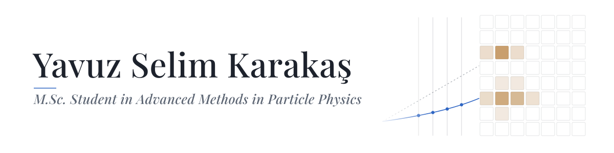

<picture>
  <source media="(prefers-color-scheme: dark)" srcset="assets/banner-dark.svg">
  
</picture>

I'm a master's student in the Erasmus Mundus joint programme **Advanced Methods in Particle Physics (IMAPP)**, which takes me through Université Clermont Auvergne, TU Dortmund and Università di Bologna. My work sits where detector physics meets software: scintillators and their optics, Monte Carlo simulation with Geant4, and the acquisition and analysis code that turns detector pulses into physics.

Currently writing my master's thesis on timing for the **LHCb PicoCal**, the electromagnetic calorimeter planned for LHCb Upgrade II.

[yskarakas.com](https://yskarakas.com) · [Academic CV](https://yskarakas.com/cv) · [LinkedIn](https://www.linkedin.com/in/yskarakas/) · [selim.karakas@tu-dortmund.de](mailto:selim.karakas@tu-dortmund.de)

### Selected work

**[SIS3316 DAQ & Analysis Suite](https://github.com/yskarakas/SIS3316_DAQ)** 
A self-contained C++17 / Qt6 / ROOT application for the Struck SIS3316-250-14 digitizer (16 channels, 250 MS/s, 14 bit): live acquisition, full hardware configuration, FPGA look-up-table coincidence triggering, direct-to-ROOT recording and offline analysis in a single program.

**[OIMD-NaI](https://github.com/yskarakas/OIMD-NaI)** 
Simulation and data behind *Optical-input model dependence in Geant4 light-collection corrections: a NaI(Tl) case study* (Y. S. Karakaş, Ö. Beysi; submitted to *Nucl. Instrum. Methods A*). A containerised Geant4 11.4 application, the published run records, and scripts that regenerate every simulated number in the paper.

**Reflective coatings and scintillator efficiency** · TÜBİTAK 2209-A 
Geant4 simulation set against measurement: how diffuse and specular reflectors change light collection in organic and inorganic scintillators. Presented at [YEFIST 2025](https://indico.cern.ch/event/1532019/contributions/6526620/) and at the 11th BCD ISHEP Cargèse School (2026).

**Low-cost FPGA gamma spectrometer** · RADMON / Istanbul University 
A NaI(Tl) detector read out by a Red Pitaya STEMlab 125-14, with digital pulse-height analysis and real-time acquisition over SCPI in Python.

### Toolbox

**Simulation & analysis** — Geant4, ROOT / RooFit, C++, Python (NumPy, SciPy, pandas, Matplotlib), Fortran 
**Instrumentation** — FPGA, VHDL, Red Pitaya, Struck SIS3316, Raspberry Pi, Arduino, NVIDIA Jetson 
**Engineering** — Qt, CMake, Docker, Linux
